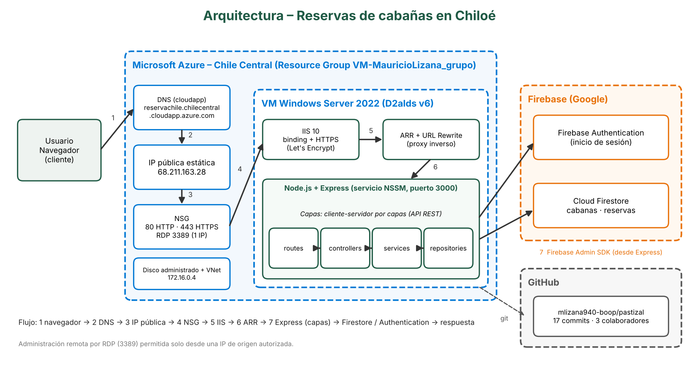

# Reservas de cabañas en Chiloé

Aplicación web de reservas de cabañas en Chiloé. Cualquier visitante puede explorar cabañas y disponibilidad. Para solicitar una reserva debe crear una cuenta con correo y contraseña; después inicia sesión, completa sus datos y puede consultar el estado de sus solicitudes. El personal administrador usa el mismo acceso y gestiona cabañas y solicitudes desde un panel privado.

## Arquitectura

La arquitectura principal es **cliente-servidor**:

```text
Visitante ⇄ catálogo público (HTML/CSS/JS) ⇄ API Node.js + Express ⇄ Cloud Firestore
Cliente o administrador ⇄ Firebase Authentication → token verificado por la API
```

El navegador no escribe en Firestore. La API recibe las solicitudes, valida los datos y aplica las reglas de negocio antes de usar Firebase Admin SDK. Las carpetas `controllers`, `services`, `models` y `repositories` ordenan el código del servidor; no representan una arquitectura MVC que el equipo deba presentar.

### Despliegue en Azure



> **Nota:** El recuento de commits del gráfico corresponde al momento en que se creó. En la versión actual, las imágenes se guardan como URLs públicas directas en Firestore, según la sección «Imágenes de cabañas»; el disco dibujado no implica que se use para almacenar imágenes.

## Estructura

```text
src/
  app.js
  server.js
  config/firebaseAdmin.js
  routes/
  controllers/
  services/
  models/
  repositories/
  middleware/
  utils/
public/
  admin/
  cliente/
    reservas.html
    reservas.js
  css/
```

La vista `/` y `/cliente/` permite explorar cabañas sin iniciar sesión. El acceso compartido está en `/cuenta.html`; después de crear la cuenta, la persona inicia sesión para continuar con la solicitud guardada. `/cliente/reservas.html` muestra las reservas asociadas a la cuenta autenticada. Firebase Authentication administra las cuentas; no se mantiene una colección separada de usuarios conectados. Cada reserva guarda el UID de Firebase Authentication en `clienteUid`. El enlace de administración conduce al mismo acceso y el servidor autoriza el panel solo a administradores.

## Requisitos locales

- Node.js 22 o superior.
- Un proyecto de Firebase con Cloud Firestore y Authentication.
- Una cuenta de servicio de Firebase para la API. No guardes ese archivo en el repositorio.

Instala dependencias y copia `.env.example` a `.env`:

```powershell
npm install
Copy-Item .env.example .env
```

Completa `FIREBASE_PROJECT_ID` y configura credenciales de servidor. En desarrollo puedes usar `GOOGLE_APPLICATION_CREDENTIALS` apuntando a un archivo de cuenta de servicio guardado fuera del repositorio, o definir `FIREBASE_SERVICE_ACCOUNT_JSON` en `.env`. En el servicio Azure, configura la credencial como variable de entorno protegida del servicio.

En Firebase Authentication habilita el proveedor de correo y contraseña y crea la cuenta de administración. Copia su UID en `FIREBASE_ADMIN_UIDS`; para varios administradores, separa los UID con comas. Configura también la aplicación web en `public/admin/firebase-config.js`. Ese archivo solo contiene la configuración cliente de Firebase; nunca pongas allí la clave privada de la cuenta de servicio.

### Imágenes de cabañas

El administrador pega una URL HTTPS pública y directa a la imagen (no a una página de galería). El panel carga una vista previa y muestra sus dimensiones; al guardar, Express valida la URL y Firestore almacena el valor en `imagenUrl`. El navegador del cliente carga la imagen directamente desde el sitio que la aloja. El servidor de la aplicación no recibe, almacena ni sirve archivos de imagen, por lo que la URL debe ser accesible sin iniciar sesión y mantenerse disponible. Si una cabaña conserva una ruta antigua `/uploads/...`, reemplázala por una URL pública antes del despliegue.

## Validaciones de formularios

El registro y el inicio de sesión usan Firebase Authentication: correo válido y contraseña de 6 a 128 caracteres; el registro confirma que ambas contraseñas coincidan. Las reservas validan nombre completo, correo asociado a la sesión, teléfono de 8 a 15 dígitos, fechas futuras y en orden, estadías de hasta 30 noches y huéspedes dentro de la capacidad. La administración valida nombre, precio entero de $1 a $10.000.000 CLP, capacidad de 1 a 30, descripción de hasta 1.000 caracteres, hasta 20 comodidades únicas y una URL HTTPS pública válida para la imagen. Las reglas principales se vuelven a validar en el servidor antes de guardar.

Despliega las reglas e índices de Firestore desde el directorio del proyecto después de seleccionar el proyecto Firebase correcto:

```powershell
firebase deploy --only firestore:rules,firestore:indexes
```

Inicia la aplicación:

```powershell
npm run dev
```

Abre `http://localhost:3000`. La API responde en el mismo origen; `GET /api/health` sirve como comprobación básica del servidor.

## Datos en Firestore

- `cabanas`: nombre, descripción, precio por noche, capacidad, comodidades y estado.
- `reservas`: UID de Firebase Authentication, cabaña, datos de contacto del cliente, fechas, huéspedes, total estimado y estado.
- `cabanas/{cabanaId}/nochesOcupadas/{AAAA-MM-DD}`: bloqueo de cada noche de una reserva pendiente o confirmada.

La solicitud valida que las fechas sean válidas y que la entrada no sea anterior al día actual de Chile, además del contacto, capacidad y disponibilidad. Las noches se bloquean junto con la reserva en una transacción. Las reservas pendientes bloquean fechas hasta que administración las confirme, rechace o cancele. Las solicitudes pendientes de más de 24 horas generan una alerta en el panel; el sistema no las cancela automáticamente. Al eliminar una cabaña se borran sus datos y noches ocupadas, pero se conservan las reservas históricas, que guardan una copia del nombre y precio. Para proteger reservas vigentes, no se permite eliminar una cabaña con solicitudes pendientes o confirmadas.

El archivo `firestore.rules` deniega acceso directo desde clientes web. La API usa Firebase Admin SDK, que opera con credenciales de servidor; por eso la autorización de administrador se verifica en Express. Las consultas paginadas y alertas usan índices compuestos declarados en `firestore.indexes.json`; despliega las reglas y los índices antes de publicar esta versión.

## API

### Rutas públicas

- `GET /api/cabanas`: lista cabañas activas; acepta `fechaEntrada`, `fechaSalida` y `huespedes` para filtrar por disponibilidad y capacidad.

### Rutas que requieren iniciar sesión

- `POST /api/reservas`: registra una solicitud pendiente y valida disponibilidad. Requiere Firebase ID token en `Authorization: Bearer <token>`; el correo y UID del cliente se obtienen de la sesión validada.
- `GET /api/mis-reservas?cursor=<id>`: devuelve en páginas de 20 las reservas asociadas al UID autenticado. El cursor es opcional y lo devuelve la respuesta cuando existen más resultados.

### Rutas de administrador

Todas requieren un Firebase ID token en `Authorization: Bearer <token>` y una cuenta autorizada por UID en `FIREBASE_ADMIN_UIDS` o por la custom claim `admin: true`.

- `GET /api/admin/session`
- `GET /api/admin/cabanas`
- `POST /api/admin/cabanas`
- `PUT /api/admin/cabanas/:id`
- `DELETE /api/admin/cabanas/:id`: elimina la cabaña y sus noches ocupadas; conserva las reservas históricas y responde con conflicto si aún hay reservas pendientes o confirmadas.
- `GET /api/admin/reservas?estado=pendiente&cursor=<id>`: devuelve en páginas de 20. `estado` y `cursor` son opcionales; la respuesta incluye `nextCursor` y una alerta global si hay solicitudes pendientes de más de 24 horas.
- `PATCH /api/admin/reservas/:id/estado` con `estado`: `confirmada`, `rechazada` o `cancelada`.

Los estados permitidos son `pendiente`, `confirmada`, `rechazada` y `cancelada`. Rechazar o cancelar libera las noches; una reserva confirmada también puede cancelarse.

## Seguridad

- No subas `.env`, cuentas de servicio, contraseñas ni tokens.
- La API devuelve un error genérico ante fallos internos y mantiene los datos privados de clientes detrás de autenticación administrativa.
- Las reglas de Firestore no sustituyen la autorización de Express cuando se usa Firebase Admin SDK.
